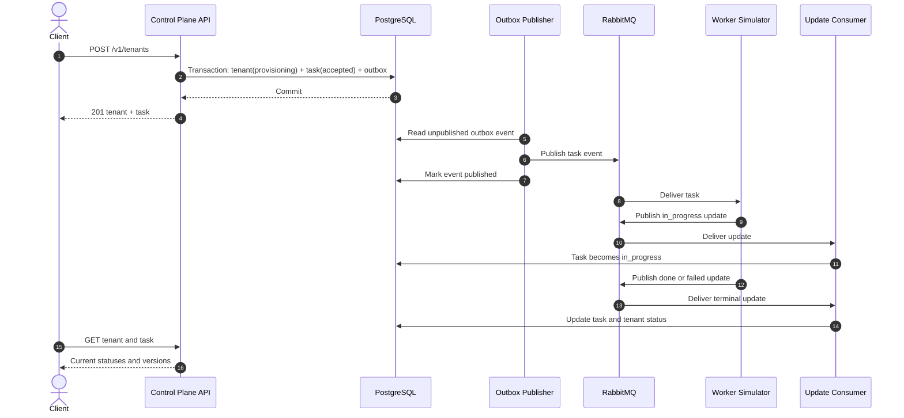
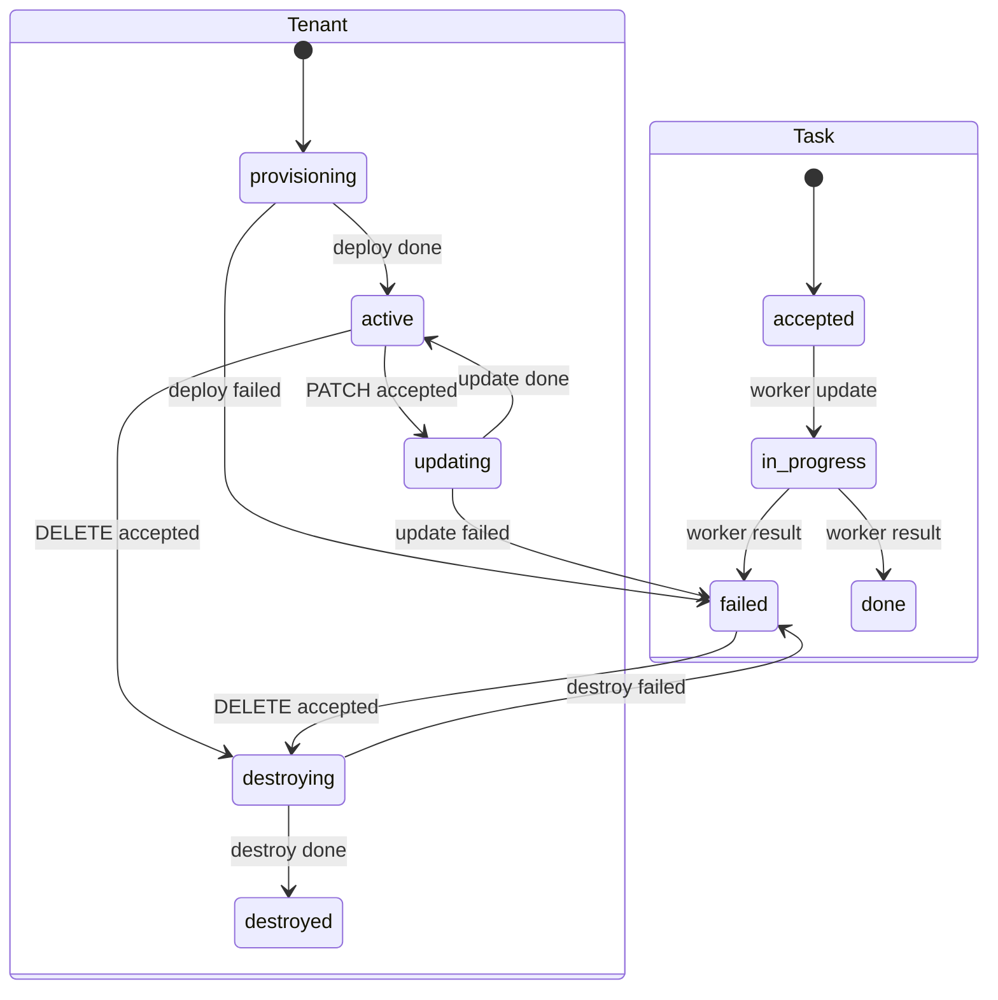

# Architecture and State Flow

## Components

- **HTTP API** validates tenant operations and reads tenant/task state.
- **PostgreSQL** stores tenants, tasks, outbox events, and processed worker updates.
- **Outbox publisher** publishes committed task events to RabbitMQ and marks them published.
- **Worker simulator** consumes accepted tasks and emits `in_progress`, then `done` or `failed` updates.
- **Update consumer** applies task updates and terminal tenant status changes.
- **RabbitMQ** carries task events to workers and worker updates back to the API service.

The API container runs the outbox publisher and update consumer in its application lifespan. The worker is a separate process/container.

## Tenant and Task Lifecycle

The lifecycle states are:

## Design Decisions

### Transactional outbox

The tenant mutation, task, and outbox event are stored in one database transaction. The publisher sends the event only after it can read the committed outbox row. If publishing fails, the row remains available for a later attempt; this avoids losing a task between a database commit and broker publication.

### At-least-once delivery and idempotency

RabbitMQ delivery and publishing can be retried. Each worker update has a stable `update_id`, recorded in PostgreSQL before its state change is applied. Repeated updates are ignored. Task transitions also reject stale changes so a late `in_progress` update cannot regress a terminal task.

### Tenant version semantics

Tenant `version` is used for optimistic locking of user-requested mutations. Creating a tenant starts at version 1; an accepted PATCH increments it once. Worker completion changes the tenant status and timestamp but does not increment the version. For example, a tenant stays at v1 after initial deployment, and a later accepted update advances it from v1 to v2, not v3 when the worker finishes.

### Local networking

Compose maps host ports to container ports: PostgreSQL `5433:5432`, RabbitMQ AMQP `5673:5672`, and RabbitMQ management `15673:15672`. Containers use service DNS names and internal ports; host port mappings are for tools running outside Compose.